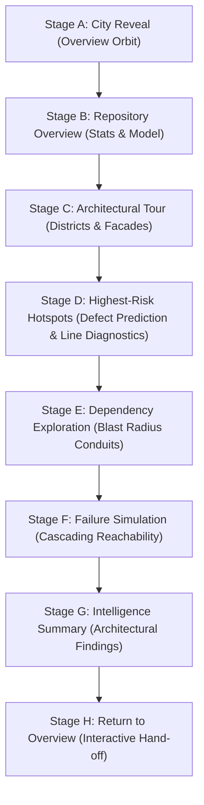

# CODECITY AI — PHASE 6: EXHIBITION & PRESENTATION ENGINE DESIGN SPECIFICATION

## 1. Executive Summary & Design Mission
The objective of Phase 6 is to transform CodeCity AI's Exhibition Mode from a simple rotating hotspot cycler into a **cohesive, cinematic, hands-free architectural demonstration engine**. The engine communicates the full value proposition of software architecture intelligence—establishing context, highlighting structural bottlenecks, predicting defect probabilities, exploring dependency blast radius, and demonstrating cascading failure propagation—grounded 100% in real repository data without cloud dependencies or fabricated metrics.

---

## 2. Presentation Sequence Architecture (Stages A through H)

The presentation sequence consists of 8 choreographed stages. Each stage has a distinct narrative objective, camera framing, highlighted data, and duration.



### Stage Details & Technical Specifications

| Stage ID | Stage Name | Target Duration | Camera Framing | Data Displayed & Interactions | Graceful Fallback (Sparse/Missing Data) |
| :--- | :--- | :--- | :--- | :--- | :--- |
| **A** | **City Reveal** | 6.5s | High-angle establishing orbit ($R \approx 1.6 \times \text{span}$, $\theta = 45^\circ$, $y = 36\text{m}$) | Title banner: "CodeCity AI", Repository Name, Mission statement ("Real-time 3D Software Architecture & Defect Propagation"). Smooth intro sweep. | Works on all repos. Small repos apply hero footprint scaling. |
| **B** | **Repository Overview** | 7.0s | Elevated isometric overview ($R \approx 1.4 \times \text{span}$, centered on district centroids) | Total Analyzed Files, Total LOC, Average Defect Risk %, Critical Hotspots Count, Model ROC-AUC (held-out split). | If ROC-AUC is absent from payload, shows "XGBoost Temporal Classifier (Offline)". |
| **C** | **Architectural Tour** | 8.5s | Low-altitude district glide sweeping across district platforms ($y = 14\text{m}$, $\theta = 30^\circ$) | Highlights district grouping (squarified treemap), architectural archetypes (10 procedural styles), footprint (LOC) and height (Cyclomatic Complexity). | Repositories with single root district highlight individual module clusters. |
| **D** | **Highest-Risk Hotspots** | 9.0s | Close building focus ($45^\circ$ contextual framing, offset to accommodate left/center HUD) | Selects highest ML-risk file. Displays filename, path, defect probability %, LOC, complexity, 90-day churn, SHAP features, and line-level failure diagnostics. | Plain-English heuristic explanation if SHAP weights are absent. |
| **E** | **Dependency Exploration** | 8.0s | Mid-range perspective framing origin building and caller network ($R \approx 32\text{m}$) | Focuses file with highest blast radius. Renders glowing 3D parabolic conduits. Displays Hop 1 (immediate callers), Hop 2, and Hop 3 dependents. | If file has 0 dependencies, explains "Modular leaf file with zero incoming couplings". |
| **F** | **Failure Simulation** | 8.5s | Dynamic dramatic elevation viewing contagion propagation wave | Triggers live cascading failure simulation (`simulateFailure(file)`). Origin pulses crimson, dependents flash in temporal sequence. Clear disclaimer: "Static Reachability Simulation". | If repo has 0 internal edges, notes "Isolated units: Zero upstream blast exposure". |
| **G** | **Intelligence Summary** | 7.5s | Elevated three-quarter overview | Synthesizes verified findings: Top risk file, architectural bottlenecks (Betweenness Centrality), detected code smells, bus factor concentration. | Displays only verified findings available in current payload. |
| **H** | **Return to Overview** | 5.0s | Smooth return to default overview camera framing | Dismisses simulation cleanly (`simulateFailure(null)`). Displays "Tour Complete" with options to Restart Tour or Return to Free Interactive Exploration. | Restores normal user interaction seamlessly. |

---

## 3. Camera Choreography & Interpolation Engine

### 3.1 Single Coordinated Camera System
To eliminate competing animation loops and abrupt jumps, all presentation camera transitions are coordinated by a unified controller in `CityScene.tsx` interacting with `OrbitControls`:
1. **Target Vector Interpolation**: Controls target smoothly lerps between stage focal points using cubic ease-out curves ($t \mapsto 1 - (1-t)^3$).
2. **Spherical Position Orbit**: Camera position moves along a smooth spherical path $(r, \theta, \phi)$ to prevent cutting through tall buildings.
3. **Suspension of Ambient Drift**: Ordinary idle camera drift is strictly suspended during active presentation stages.
4. **No-Clip Assurance**: Minimum camera elevation is clamped to $\max(6.0, \text{targetBuildingHeight} \times 0.6)$ to prevent clipping into roofs or platforms.

### 3.2 Reduced Motion Mode (`prefers-reduced-motion`)
When reduced motion is detected or configured:
- Camera transitions snap or cross-fade gently over static angles rather than executing rapid multi-axis sweeps.
- Particle drift velocities and pulsing frequencies are reduced by $80\%$.

---

## 4. Presentation HUD Architecture

### 4.1 Layout & Visual Hierarchy
```
+-----------------------------------------------------------------------------------+
| [CodeCity AI • Exhibition Mode]  pallets/flask (15 files)      [Pause (Space)] [X]|
+-----------------------------------------------------------------------------------+
|                                                                                   |
|                                                                                   |
|                                ( 3D Canvas Scene )                                |
|                                                                                   |
|                                                                                   |
+-----------------------------------------------------------------------------------+
| Stage 4 of 8: Highest-Risk Hotspots [========>            ] [Prev] [Next] [Reset] |
| --------------------------------------------------------------------------------- |
| FILE: src/flask/app.py | 88% Defect Risk | 4,210 LOC | 42 Complexity              |
| DIAGNOSIS: Line 1284 in wsgi_app: AttributeError - Missing request context        |
+-----------------------------------------------------------------------------------+
```

### 4.2 HUD Component Specifications
- **Top Bar**:
  - Live pulse indicator (electric cyan).
  - Repository title and badge: Total files, Total LOC.
  - Active Stage name pill and Auto-Advance timer indicator.
  - Quick actions: Pause / Play toggle, Model Card modal, Exit Exhibition (`P` or `Esc`).
- **Stage Stepper Bar**:
  - Interactive numbered stage pills (1 through 8) allowing instant random-access navigation.
  - Animated horizontal progress bar reflecting exact elapsed time in current stage.
- **Narrative Callout Card**:
  - Stage-specific narrative title and concise explanation.
  - High-contrast metrics pills (LOC, Risk %, Complexity, Centrality, Blast Radius).
  - Explicit evidentiary labels: distinguishing predicted probability from confirmed runtime bug.
- **Playback Controls Bar**:
  - Previous Stage (`Left Arrow`), Pause/Resume (`Space`), Next Stage (`Right Arrow`), Restart (`R`), Exit (`Esc`).
  - Clear keyboard shortcut legend visible on screen.

---

## 5. Control Modes & Attract Mode Specification

### 5.1 Automatic Mode vs Manual Mode
- **Automatic Mode**: Advances automatically through stages upon timer completion. Pausing halts the timer and retains the current stage indefinitely.
- **Manual Mode**: Presenter can click any stage pill or use keyboard shortcuts (`Left`/`Right`) to jump between stages. Advancing manually resets the stage timer.

### 5.2 Attract Mode (Configurable Opt-In)
- **Deliberate Opt-In**: Attract mode is controlled via an explicit setting toggle in `useCityStore` (`isAttractModeEnabled`, default `false`). It is NEVER forced upon an active user without permission.
- **Inactivity Detection**: When enabled, an inactivity timer tracks user input (`mousemove`, `mousedown`, `keydown`, `touchstart`). If idle time exceeds 45s, Exhibition mode is triggered automatically.
- **Graceful De-escalation**: As soon as the user interacts with mouse or keyboard, Attract mode yields immediately, smoothly returning camera and UI controls to normal interactive mode without sudden disorientation.

---

## 6. Performance & Low-Power Budget
- **Target Frame Rate**: $>55$ FPS on integrated GPUs; $>140$ FPS on modern dedicated GPUs.
- **Instanced Geometry Reuse**: Reuses existing building archetype instanced meshes and ground shaders; zero extra Three.js draw calls created for the presentation.
- **Zero Cloud Footprint**: 100% offline, zero network telemetry, self-hosted fonts.
- **Low-Power Mode Degradation**: When Low-Power mode is active, stage transitions reduce postprocessing passes and particle count without disrupting the sequence.
