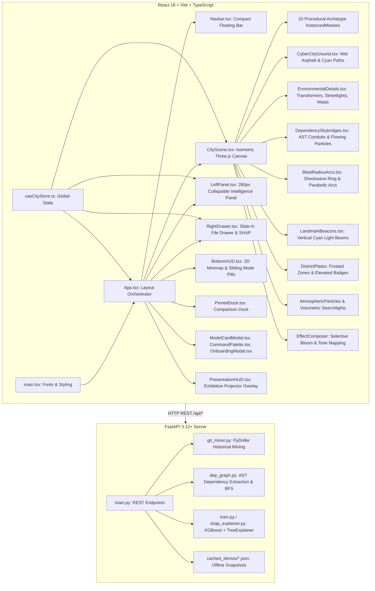

# CodeCity AI — Miniature Cyber-Metropolis Redesign Plan

## 1. Vision & Architecture Overview

Transform CodeCity AI into a high-fidelity miniature futuristic smart city / industrial software simulation diorama viewed from an elevated isometric perspective.

---

## 2. Milestone Execution Plan

### Milestone 1: 10 Procedural Architectural Archetypes & Facade Shader
- 10 distinct, richly detailed architectural archetypes constructed with merged compound `BufferGeometry` (sharp rectangular prisms, chamfered stepped setbacks, cantilevered sections, roof cooling chillers/HVAC units, communication masts, equipment bulkheads, and flat roof decks with parapets).
- Custom procedural facade shader with dual-temperature lighting (warm golden interior lights + cool cyan workstation lighting), dark tinted glass spandrels, crisp vertical mullions, subtle window flicker, slow crimson pulse on high-risk files, Fresnel edge rim lighting, and vertical luminance gradients.

### Milestone 2: City Environment, Ground, Illuminated Pathways & Environmental Details
- Deep midnight-navy wet reflective ground plane (`CyberCityGround.tsx`) with subtle procedural roughness, puddles, glowing cyan illuminated road/circuit pathways, district boundaries, and metallic service plates.
- `EnvironmentalDetails.tsx`: Small decorative industrial structures, electrical transformer cabinets, miniature streetlights with soft cyan light pools, and communication masts at district edges.
- Atmospheric depth: Layered exponential fog, distant context skyline silhouettes, glowing drifting dust/firefly particles, and volumetric searchlights.

### Milestone 3: Cyan Dependency Pathways, Camera Rig & Living Interactions
- Realistic AST dependency pathways (`DependencySkybridges.tsx`) with glowing connection nodes and animated cyan data particles streaming along conduits.
- Elevated isometric camera framing (narrower FOV 32–34°, angled diorama vantage point) with damped inertial orbit controls and smooth fly-to focusing.
- Interactive hover spring lift ($+0.4\text{m}$), cursor-following spring lag card, right-click radial quick-action menu, double-click district zoom, and signature blast-radius shockwave + parabolic arcs.

### Milestone 4: Motion-Driven UI Chrome & Spatial Panels
- Compact single-row top navigation bar with brand badge, repository selector, `⌘K` command palette trigger, camera reset, WebAudio toggle, Eco mode toggle, Exhibition mode toggle, and Model Card button.
- Floating collapsible left panel (280px) with animated SVG sparklines on KPI cards, scanner, and ranked hotspots with bidirectional 3D hover sync.
- Slide-in right drawer with animated circular risk gauge, plain-English SHAP explanation, feature contribution bars, and blast radius trajectory drilldown.
- Bottom HUD with real-time 2D radar minimap, sliding mode pills (`layoutId="activeColorModePill"`), and skyline toggle.
- Pinned comparison dock, self-drawing animated SVG ROC curve in Model Card modal, and Command Palette.

### Milestone 5: Motion Polish, Procedural WebAudio & Exhibition Mode
- 100% offline WebAudio sound synthesizer for micro-ticks, clicks, whooshes, and blast waves.
- Exhibition mode with automatic camera orbit, rotating hotspot showcase, large projector typography, and 45-second inactivity attract restart.

### Milestone 6: Performance Optimization, Testing & 5-Round Screenshot Critique Loop
- 60+ FPS performance via InstancedMesh batching, shared geometries, and procedural shaders.
- Comprehensive testing: pytest backend suites (11/11), vitest frontend tests (3/3), TypeScript typecheck, and production build.
- 5-Round Screenshot Critique Loop across 1920×1080 and 1366×768 on dense (`flask`, `requests`) and sparse (`ecotrace-ai`) repositories.
- Updated documentation in `README.md`.

