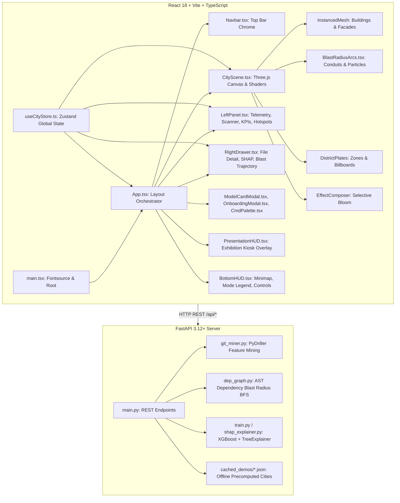

# CodeCity AI — Cinematic Redesign Architecture & Implementation Plan

## 1. Executive Summary & Goals
Transform the functional CodeCity AI codebase into a world-class, cinematic developer tool that delivers the core promise: **"See where your code will break next, and what breaks with it."**
The application will feature an immersive 3D metropolis (Blade Runner 2049 / Tron: Legacy meets Linear / visionOS), ultra-refined glass chrome, full-screen canvas hero layout, a signature shockwave + particle conduit blast-radius effect, a top-down minimap, a `Ctrl+K` Command Palette, and an exhibition presentation mode with inactivity attract triggers.

---

## 2. Existing Architecture Overview

---

## 3. Files Targeted for Modification & Creation

| File | Status | Planned Architectural Enhancements |
| :--- | :--- | :--- |
| **`frontend/src/index.css`** | Modify | Modern glassmorphism tokens, cyber neon utilities, animated scanlines, radial void background, custom scrollbars |
| **`frontend/tailwind.config.js`** | Modify | Extended color tokens (`bg-void`, `surface-glass`, `accent-teal`, `hop-1/2/3`), animation keyframes, backdrop blur classes |
| **`frontend/src/store/useCityStore.ts`** | Modify | Add low-power mode state, command palette toggle, left panel collapse toggle, camera reset trigger, last user activity tracking |
| **`frontend/src/components/City3D/CityScene.tsx`** | Modify | Procedural facade window material, wet reflective asphalt ground, layered atmospheric fog, dynamic sparse-city scaling, camera establishing intro fly-in, smooth selection framing |
| **`frontend/src/components/City3D/BlastRadiusArcs.tsx`** | Modify | Parabolic 3D tubes + animated glowing packet particles flowing along conduits + expanding ground shockwave ring + staggered hop illumination |
| **`frontend/src/components/Navbar.tsx`** | Modify | Streamlined single-row floating bar, compact repo dropdown, Low-Power toggle, Command Palette trigger (`Ctrl+K`), Exhibition toggle |
| **`frontend/src/components/LeftPanel.tsx`** | Modify | Slimmer collapsible floating glass panel (`320px`), compact KPI cards with visual distribution pills, real-time hotspot hover-synchronization |
| **`frontend/src/components/RightDrawer.tsx`** | Modify | Sleek slide-in glass drawer, glowing SVG risk gauge, animated SHAP horizontal bars with positive/negative bifurcation, interactive hop drilldown |
| **`frontend/src/components/BottomHUD.tsx`** | Create | Floating bottom HUD with interactive 2D top-down minimap, active color mode legend pills, and view controls |
| **`frontend/src/components/CommandPalette.tsx`** | Create | Fast searchable action modal (`Ctrl+K` / `Cmd+K`) for switching repos, color modes, searching files, toggling panels and low-power mode |
| **`frontend/src/components/PresentationHUD.tsx`** | Modify | Cinematic projector overlay, cycling top hotspot highlights, auto-blast radius demo, and inactivity attract timer |
| **`frontend/src/components/ModelCardModal.tsx`** | Modify | Animated SVG ROC curve drawing, XGBoost vs Churn baseline comparison, training specs, honest methodology |
| **`frontend/src/utils/cityLayout.ts`** | Modify | Intelligent scaling and centering for sparse repositories ($< 15$ files), improved district padding, refined building proportions |

---

## 4. Implementation Milestones

### Milestone 1: Audit and Baseline (Completed)
- Full inventory of all components, shaders, routes, stores, and backend endpoints.
- Baseline verification: Vitest passes (3/3), Frontend build passes (0 errors), Pytest passes (11/11).
- Inspected demo data: identified sparse repo (`atharvmaheshagowda_ecotrace-ai`, 4 files) and dense repos (`pallets_flask`, `pallets_click`, `psf_requests`).

### Milestone 2: Design System & Tokens
- Write `DESIGN_SYSTEM.md`, `REDESIGN_PLAN.md`, update `TODO.md`.
- Update `tailwind.config.js` and `index.css` with the complete cyber-metropolis color scale, glassmorphism tokens, and micro-interaction animations.

### Milestone 3: 3D City & Visual Ambiance
- Implement procedural window facade system on `InstancedMesh`.
- Build wet reflective asphalt ground with cyber coordinate grid.
- Add dynamic sparse-city layout scaling in `cityLayout.ts`.
- Implement camera intro fly-in and smooth selection framing.
- Upgrade `BlastRadiusArcs.tsx` with parabolic glowing tubes, animated data pulses, ground shockwave ring, and hop color coding.
- Add Low-Power rendering mode toggle.

### Milestone 4: Interface Chrome Redesign
- Redesign `Navbar.tsx` into a single-row floating header.
- Transform `LeftPanel.tsx` into a collapsible floating glass panel with compact KPI cards and interactive hotspot ranking.
- Build `BottomHUD.tsx` with real-time 2D minimap and color mode legend.
- Build `CommandPalette.tsx` with full keyboard shortcuts (`Ctrl+K`).
- Redesign `RightDrawer.tsx` with animated circular gauge and SHAP bars.
- Refine `ModelCardModal.tsx` with animated ROC curve.

### Milestone 5: Exhibition & Attract Mode
- Enhance `PresentationHUD.tsx` with large projector typography and cycling hotspot previews.
- Implement inactivity detection timer (45 seconds) that triggers attract mode and cleanly cancels on user interaction.

### Milestone 6: Mandatory Screenshot Critique Loop (4+ Rounds)
- Launch the application dev server.
- Run browser subagent at 1920×1080 and 1366×768 on both dense and sparse repositories.
- Document Top 10 weaknesses per round, fix them in source code, and re-verify until pristine.

---

## 5. Performance Risks & Mitigations

1. **Draw Call Explosion**:
   - *Risk*: Rendering hundreds of individual meshes or point lights will degrade frame rates.
   - *Mitigation*: Strictly maintain single `InstancedMesh` for all buildings. Geometry and materials are shared. Conduits reuse instanced / pooled tube geometries. Single directional light + hemisphere light + ambient.
2. **Postprocessing Overhead**:
   - *Risk*: Heavy multi-pass bloom can reduce FPS on laptops.
   - *Mitigation*: Limit postprocessing to a single selective Bloom pass. Provide an immediate Low-Power mode toggle that shuts down postprocessing when needed.
3. **Window Facade Shader Memory**:
   - *Risk*: High-resolution textures or per-vertex calculations.
   - *Mitigation*: Procedural shader computation in fragment stage using UV coordinates and instance ID hash. No texture memory required.

---

## 6. Verification Strategy

- **Build & Types**: `npm run build` (`tsc -b && vite build`) must pass without errors or warnings.
- **Unit Tests**: `npm run test` (Vitest) must pass.
- **Backend Tests**: `pytest backend/tests` must pass.
- **Offline Guarantee**: Grep entire codebase for `http://` / `https://` / CDN links to confirm zero external runtime dependencies.
- **Critique Rounds**: Minimum 4 documented rounds with screenshots at 1080p and 1366x768 across dense and sparse repositories.
