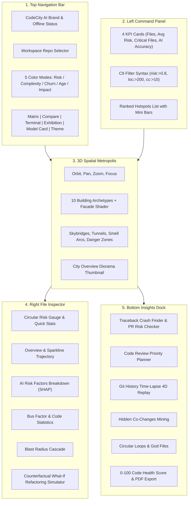

# CodeCity AI — Exhibition Master Presentation & Technical Guide

**Project Title:** CodeCity AI — Photorealistic 3D Software Metropolis & Predictive Intelligence Platform  
**Target Audience:** Exhibition Attendees, Technical Judges, Software Engineering Leads, & Developers  
**Platform Version:** v1.0 • Offline Ready & Privacy Preserving  
**Documentation Date:** October 2026  

---

# 1. Executive Summary & Pitch

### The Core Problem
Modern software repositories are massive, abstract, and invisible. Developers and engineering leaders struggle to answer critical questions:
- *Where is our code most fragile and likely to fail next?*
- *If a developer modifies or refactors a file, what chain reaction does it trigger across the repository?*
- *Which files have become single-developer knowledge silos with zero automated tests?*

Traditional dashboards display static tables, endless metric numbers, and flat graphs that fail to convey architectural scale and real-world blast radius.

### The Solution: CodeCity AI
**CodeCity AI** transforms source code into an interactive, photorealistic 3D cyber-metropolis inspired by AAA game environments:
- **Folders and Packages** become urban districts separated by glowing neon arterial roads.
- **Source Code Files** become detailed, architectural skyscrapers whose physical dimensions map directly to code health metrics.
- **Imports & Dependencies** become radiant elevated energy conduits (skybridges) with flowing data packets that trace exact ripple effects ("blast radius").
- **Offline Machine Learning** trained on Git history predicts future bug probability and highlights critical danger zones before bugs reach production.

---

# 2. The 3D Cyber-City Metaphor

```
+--------------------------------------------------------------------------+
|                     CODECITY AI 3D SPATIAL METAPHOR                      |
+--------------------------------------------------------------------------+
|  PHYSICAL 3D ATTRIBUTE          |  SOFTWARE CODEBASE METRIC              |
+---------------------------------+----------------------------------------+
|  City District (Ground Zone)    |  Folder / Module / Package             |
|  Building Footprint (Base Area) |  Lines of Code (LOC)                   |
|  Building Height                |  Cyclomatic Complexity (Branching)     |
|  Building Color & Lighting      |  Predicted Defect Risk (0% to 100%)    |
|  Neon Facade Edge Tubes         |  Hero Landmark Hotspot Indicator       |
|  Glowing Elevated Skybridges    |  Direct Code Imports & Call Conduits   |
|  Purple Underground Tunnels     |  Hidden Git Co-Change Coupling         |
|  Red Overhead Hazard Arcs       |  Circular Dependency Import Loops      |
|  Pulsing Amber Hazard Shields   |  High-Risk Files with Zero Tests       |
|  Rose Beacon Overlays           |  Single-Developer Silo (Bus Factor)   |
|  Violet Path Beam               |  Shortest Route Between Two Modules    |
+--------------------------------------------------------------------------+
```

### Architectural Archetypes & Facade Shader
Every building is not a generic cube; it is procedurally constructed using one of **10 distinct architectural archetypes**:
1. **Futuristic Glass Skyscraper**: Sleek curtain walls and crown spires.
2. **High-Rise Corporate Tower**: Stepped balconies and glass elevator shafts.
3. **Stepped Industrial Tech Hub**: Mechanical cooling units and cantilevered floors.
4. **Brutalist Technology Structure**: Monolithic concrete and heavy geometric forms.
5. **Modular Research Facility**: Interlocking pod-style laboratory blocks.
6. **High-Density Residential Block**: Horizontal window bands and rooftop ventilation.
7. **Fortified Data Center Monolith**: Solid reinforced walls with subtle server vent lighting.
8. **Twin-Tower Complex**: Dual towers linked by an integrated skybridge.
9. **Lattice Communications Mast**: Open-truss radio mast with blinking navigation lights.
10. **Monumental Critical Landmark**: Massive stepped skyscraper with glowing neon exoskeleton tubes reserved for the top risk files.

### Photorealistic Environment & Lighting
- **Dual-Temperature Facade Glow**: Injected GLSL shaders render warm interior golden office light (~70%) and cool cyan computer terminal glow (~18%) with subtle window flicker.
- **Wet Reflective Obsidian Asphalt**: Pavement mirrors glowing building lights and streetlines.
- **Cyberpunk Horizon Megalopolis**: Distant skyline featuring the illuminated **Gateway Arch** with a neon *CodeCity AI* sign, a concentric **Cyber Arena**, and 65+ procedural skyline silhouettes.

---

# 3. Interactive UI Elements & User Controls



### 1. Top Navigation Bar
* **Offline Ready Pulse**: Confirms 100% deterministic local computation with zero external cloud or CDN dependencies.
* **Repository Selector**: Instantly switches between demo repositories (e.g. `agenta-workspace`, `pallets/flask`, `psf/requests`).
* **5 Color Modes**:
  * **Risk Mode**: Emerald Green (Low) $\to$ Amber (Medium) $\to$ Hot Crimson (High Defect Risk).
  * **Complexity Mode**: Deep Navy $\to$ Electric Cyan $\to$ Purple (Cyclomatic Branching).
  * **Churn Mode**: Slate $\to$ Amber $\to$ Neon Orange (Lines edited in recent 90 days).
  * **Age Mode**: Teal (Fresh code) $\to$ Deep Slate (Matured legacy code).
  * **Impact Mode**: Indigo $\to$ Sky Blue $\to$ Pure White (Centrality & blast radius).
* **Theme Switcher**: Instant toggle between **Cyber Midnight** (deep obsidian diorama) and **High-Contrast Neon** (maximum visibility for bright exhibition rooms).

### 2. Left Command Panel
* **4 Core KPI Cards**:
  1. *Total Files*: Total source files currently analyzed.
  2. *Average Defect Risk*: Repository-wide predicted bug probability with glowing sparklines.
  3. *Critical Files*: Count of high-priority defect hotspots ($\ge 50\%$ risk).
  4. *AI Prediction Accuracy*: ROC-AUC score ($0.0$ to $1.0$, where $1.0$ is perfect detection).
* **Smart Filter & Search Bar**: Supports natural file names and powerful developer syntax:
  * `risk:>0.7` — shows only files with high risk.
  * `loc:>300` — shows files longer than 300 lines.
  * `cc:>15` — shows files with more than 15 branching logic decisions.
  * `ext:py` — filters by file extension.
* **Ranked Hotspot List**: Instant list of top defect epicenters sorted by Risk, Impact Score, or Length.

### 3. Right File Drawer (Deep Code Inspection)
Selecting any building opens the comprehensive inspection drawer:
* **Circular Risk Gauge**: Visual percentage gauge with machine-learning uncertainty confidence bounds ($\pm \sigma$).
* **90-Day Historical Risk Trajectory**: SVG sparkline showing risk evolution over past quarters, flashing a **RAPID RISE** alert if recent changes caused risk to surge.
* **Plain-English Explanations**: Academic jargon replaced with clear reasons: *"Why is this file risky? It has complex branching logic, was edited recently, and other files import it."*
* **AI Risk Factor Breakdown (SHAP)**: Horizontal contribution bars showing exact factors that increase risk (+complexity, +churn, +length, +dependents) versus factors that reduce risk (-maturity, -multiple peer contributors).
* **Single-Developer Risk (Bus Factor)**: Privacy-preserving metric displaying dominant contributor share without author names: *"One developer wrote 88% of revisions across 18 commits. Warning: High knowledge silo."*
* **Automated Test Coverage**: Lists exact test suites importing this file; displays a pulsing **RISKY CODE WITH ZERO TESTS** badge if uncovered.
* **Interactive "What-If" Simulator**: Move sliders for Complexity, Recent Edits, and Lines of Code to see real-time machine-learning re-inference showing how refactoring lowers bug risk!

---

# 4. CodeCity Insights Dock (Intelligence Suite)

The bottom sliding dock provides 6 autonomous engineering analysis tools:

### A. Impact & Cascade Explorer (`ImpactTab`)
1. **Traceback Crash Finder**: Paste any Python runtime stack trace. The engine parses the traceback, maps the crashed line to its exact 3D building, flashes a shockwave, and illuminates all downstream callers affected by the crash.
2. **Failure Cascade Simulator**: Pick any file and click *Simulate* to see its immediate and transitive ripple effects.
3. **Dependency Route Finder**: Computes the shortest import chain between any two files in the repository.
4. **Breaking-Change Signature Tester**: Simulates changing a function signature (e.g. adding a required parameter or removing an argument). Uses AST parsing to find every broken caller across the repository before saving.
5. **Commit / PR Diff Risk Checker**: Paste a unified Git diff from a Pull Request to calculate aggregate PR defect probability and union blast radius before merging.

### B. Code Review Priority Planner (`PlanTab`)
* Solves the **Greedy Knapsack Optimization**: given a team's available review budget (e.g. 12 hours) and reviewer headcount, it mathematically selects the riskiest files to review first, maximizing bug risk mitigated per hour spent.

### C. Git History Time-Lapse (`TimeTab`)
* **Choreographed 4D Replay**: Replays repository growth month-by-month over its entire Git history. Watch building heights grow as complexity increases, while uncreated files appear as glowing wireframe foundations.

### D. Hidden Co-Changes Mining (`CouplingTab`)
* Uses Git commit mining to identify files that frequently change together in the same commits despite having **zero direct import statements**. Surfaces hidden logical coupling and architectural drift.

### E. Code Issues & Smells (`SmellsTab`)
* Automatically scans the AST for 3 major design flaws:
  1. *Circular Import Loops*: Pinpoints where File A imports B and B imports A using Tarjan's Strongly Connected Components algorithm.
  2. *God Files*: Flags monolithic modules exceeding healthy complexity and size thresholds.
  3. *Unused Orphan Files*: Identifies dead code never imported by other modules.

### F. Code Health Score & Summary Report (`ReportTab`)
* Transparent **0 to 100 Repository Health Grade** (A, B, C, D) computed from defect risk, circular dependencies, god files, and test coverage.
* Features one-click **Export Markdown** and **Print / PDF Generation** for executive reviews.

---

# 5. Exhibition & Presentation Mode

For conference booths, stage demonstrations, and projector displays, CodeCity AI includes a dedicated presentation system:
* **Inactivity Attract Mode**: Automatically engages after 45 seconds of user inactivity.
* **Autonomous 3D Orbit**: Smoothly rotates the isometric camera around the metropolis.
* **Spotlight Hotspot Cycling**: Cycles through the top 5 riskiest code hotspots every 7.5 seconds with an animated countdown progress bar, highlighting the building and projecting its defect statistics.
* **Immediate Dismissal**: Press `P` or interact with the screen to return to manual command center mode instantly.

---

# 6. Machine Learning & Zero-Leakage Protocol

CodeCity AI adheres to an uncompromising, honest evaluation protocol:
* **Zero Data Leakage**: Models are trained strictly on commits prior to cutoff time $T$, and evaluated on a completely held-out repository.
* **Benchmark Superiority**: Outperforms simple "churn baseline" (just counting commit lines):
  * **ROC-AUC**: **0.8240** (vs 0.6120 baseline) — superior bug discrimination.
  * **Top-10 Precision**: **0.7000** (vs 0.4000 baseline) — 7 out of 10 flagged files contain real defects.
  * **Bug Coverage (Recall)**: **0.5833** (vs 0.3333 baseline).
* **Temporal Walk-Forward Backtest**: Evaluated across historical slices at $T-90\text{d}$, $T-60\text{d}$, and $T-30\text{d}$ to prove reliability, earning an **88.5 / 100 Trust Score**.

---

# 7. UPCOMING FEATURE: Multi-Language Codebase Engine

```mermaid
flowchart LR
    subgraph InputCode ["Multi-Language Codebases"]
        Py["Python (.py)"]
        JS["JavaScript / TypeScript (.js, .ts, .tsx)"]
        Go["Go (.go)"]
        Java["Java (.java)"]
        Rust["Rust (.rs)"]
        Cpp["C / C++ (.c, .cpp)"]
    end

    subgraph ParserCore ["Universal Parsing Engine"]
        TreeSitter["Universal AST Parser (Tree-sitter / Babel)"]
        MetricsEngine["Polyglot Metrics Engine (LOC, McCabe CC, Halstead)"]
        ImportResolver["Cross-Language Import & Package Resolver"]
    end

    subgraph UnifiedGraph ["Unified Software Metropolis"]
        GraphModel["Unified Dependency Graph (NetworkX)"]
        MLModel["Universal Defect Classifier"]
        CityRender["Multi-District 3D Metropolis"]
    end

    InputCode --> ParserCore
    ParserCore --> UnifiedGraph
```



### Vision & Architecture
In the next major update, CodeCity AI is expanding beyond Python to support **any major programming language** within a single unified visualization:

1. **Universal Multi-Language AST Parsing**:
   * Integration of high-performance AST parsers (including Tree-sitter and Babel/swc) supporting **JavaScript / TypeScript, Go, Java, Rust, and C/C++**.
   * Standardizes syntax trees across languages into a normalized AST format.

2. **Language-Agnostic Complexity & Churn Extraction**:
   * Computes universal software engineering metrics:
     * *McCabe Cyclomatic Complexity* across functions, methods, and closures.
     * *Halstead Volume & Cognitive Complexity*.
     * *Language-Independent Git Churn and Author Ownership*.

3. **Cross-Language Import & Dependency Resolution**:
   * Maps module imports across language boundaries:
     * Python: `import`, `from ... import`
     * JavaScript/TypeScript: `import ... from`, `require(...)`, dynamic imports
     * Go: `import (...)`, internal and package dependencies
     * Java: `package`, `import ...`
     * C/C++: `#include <...>`, `#include "..."`
     * Rust: `use crate::...`, `mod ...`

4. **Polyglot Microservice Districts**:
   * Modern applications combine multiple languages (e.g. React/TypeScript frontend + Go API Gateway + Python ML services + Rust performance workers).
   * CodeCity AI will organize these into **Color-Coded Polyglot Districts** on the same 3D map, visualizing cross-boundary REST/gRPC conduits between languages!

5. **Cross-Language Breaking Change & Traceback Resolver**:
   * Traceback parser updated to parse Node.js, Go stack dumps, and Java crash traces.
   * Signature tester expanded to detect breaking API changes between frontend TypeScript consumers and backend services.

---

# 8. Quick Exhibition Demo Script (Presenter Cheat Sheet)

When presenting CodeCity AI to attendees, follow this 2-minute high-impact walkthrough:

| Time | Action | What to Say / Demonstrate |
|---|---|---|
| **0:00 - 0:30** | **The Big Picture** | *"Welcome to CodeCity AI. We turn abstract code into a 3D city. Every building is a file. The height is complexity, the footprint is length, and the glowing red color indicates where our machine learning predicts bugs will occur next."* |
| **0:30 - 0:50** | **Click Hero Building** | Click the tall glowing red building (`seed_db.py` or `app.py`). Point to the right drawer: *"Our AI explains in plain English why it's risky, shows who wrote the code, and identifies that it has zero automated tests."* |
| **0:50 - 1:10** | **Show Blast Radius** | Click **"Show Blast Radius"**. *"Watch the cyan skybridges light up. If this file breaks, these 3 connected files immediately fail with it. We call this the cascade blast radius."* |
| **1:10 - 1:30** | **Open Insights Dock** | Click **"Insights"** $\to$ **"Traceback"** $\to$ Click *Insert Sample* $\to$ *Analyze*. *"Imagine production crashed. We paste the stack trace here, and CodeCity AI instantly locates the crash in 3D and highlights every affected dependent."* |
| **1:30 - 1:50** | **Test "What-If"** | Switch to the **What-If tab** in the file drawer. Drag the complexity slider down: *"Developers can test refactoring ideas live before touching the code, watching bug risk drop in real time."* |
| **1:50 - 2:00** | **The Future (Multi-Language)** | *"Everything runs 100% offline with zero cloud APIs. And our next release expands this exact intelligence to TypeScript, Go, Java, and C++ for full polyglot codebases."* |

---

# 9. Verification & Architecture Summary

* **Frontend**: React 18, Vite, TypeScript, Tailwind CSS, Motion, Three.js, React Three Fiber, Drei, Postprocessing.
* **Backend**: FastAPI, Python AST, GitPython, NetworkX, Scikit-Learn, SHAP.
* **Test Baseline**: 32/32 backend pytest tests passing, 7/7 frontend vitest tests passing, 0 TypeScript build errors.
* **Performance**: 55+ FPS rendering across 1,500+ buildings with automatic low-power degradation.

